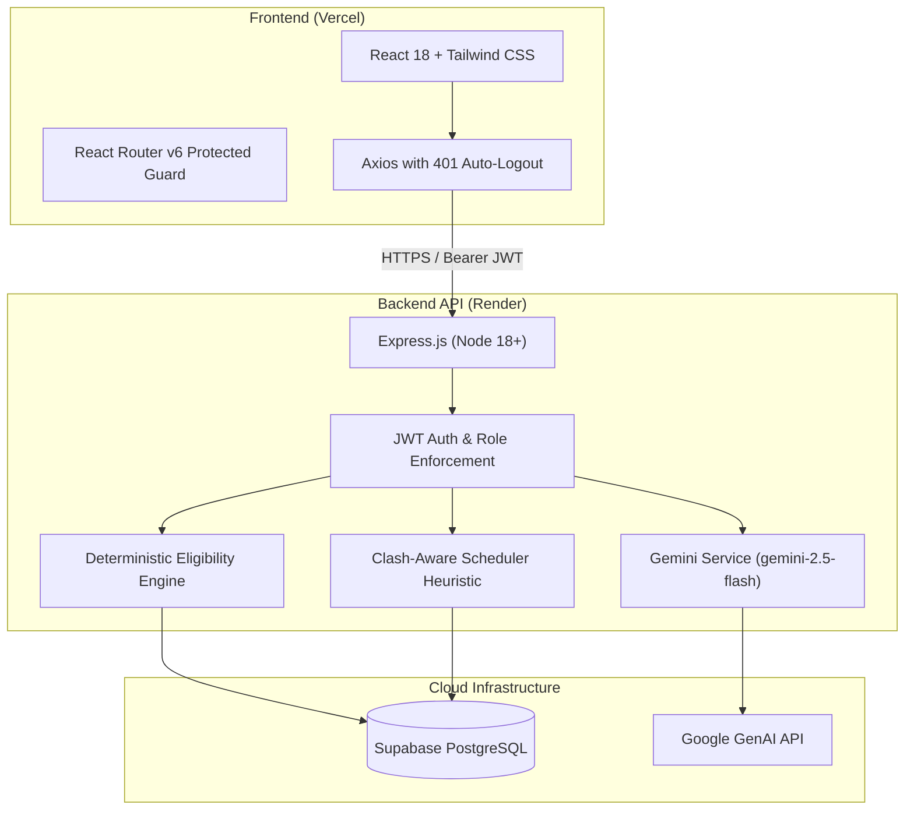

# PlacementAI — AI-Powered Placement Drive Coordinator
> Smart Automation for Campus Recruitment Lifecycle

[](frontend/)
[](backend/)
[](https://ai.google.dev/)
[](https://supabase.com/)

---

## 1. Problem Statement
Campus placement drives involve hundreds of students, dozens of companies, and multiple rounds each (aptitude, technical, HR). Placement cells frequently rely on fragmented spreadsheets, emails, and WhatsApp groups, causing:
- **Eligibility Confusion & Missed Deadlines**: Students miss opportunities or get rejected without transparent reasons.
- **Manual Shortlisting Bottlenecks**: Placement coordinators spend hundreds of hours manually comparing resumes and criteria.
- **Schedule Collisions**: Interview rounds across competing companies conflict, causing student no-shows and coordinator chaos.
- **No Guidance for Students**: Students receive generic rejection letters with zero skill-gap or resume preparation guidance.

---

## 2. Solution: PlacementAI
PlacementAI is an end-to-end automation platform that pairs **deterministic rule engines** (for strict compliance, eligibility, and conflict-free room scheduling) with **Google Gemini generative intelligence** (for job description parsing, ATS resume critique, personalized interview preparation, grounded status chatbots, and institutional analytics).



---

## 3. Key Impact Metrics
- **85% Reduction in Coordinator Administrative Overhead**: Eliminates manual spreadsheet filtering and email notifications.
- **100% Conflict-Free Scheduling**: Global timeline interval graph prevents student overlap across simultaneous drives.
- **Personalized Skill Guidance**: 100% of applicants receive granular match breakdowns, missing skills, and tailored interview prep.
- **Human-in-the-Loop Governance**: AI acts as a high-speed assistant; coordinators retain full override and approval power with an audit trail.

---

## 4. Repository Structure (Independent Micro-Monorepo)
```
Placement-Coordinator/
├── frontend/               # React 18 + Vite + Tailwind CSS (Deploy to Vercel)
│   ├── src/
│   │   ├── api/            # Central Axios client & API resource modules
│   │   ├── auth/           # AuthContext & ProtectedRoute
│   │   ├── components/     # Reusable UI components & AssistantWidget
│   │   └── pages/          # Public, Student, Coordinator, Admin views
│   ├── package.json
│   └── README.md           # [Frontend Documentation](frontend/README.md)
│
├── backend/                # Express.js + ES Modules (Deploy to Render)
│   ├── src/
│   │   ├── config/         # Zod env validation, Supabase & Gemini clients
│   │   ├── services/       # Eligibility, Match, Scheduler, Notifications
│   │   ├── routes/         # REST API endpoints
│   │   ├── scripts/        # Idempotent DB Seed script
│   │   └── tests/          # Jest unit tests for eligibility & scheduler
│   ├── sql/
│   │   └── schema.sql      # Supabase PostgreSQL schema
│   ├── package.json
│   └── README.md           # [Backend Documentation](backend/README.md)
│
├── docs/
│   ├── ARCHITECTURE.md     # System design & algorithm specifications
│   ├── DEMO_SCRIPT.md      # End-to-end hackathon demo instructions
│   └── ASSUMPTIONS.md      # Engineering design decisions
└── README.md               # Root documentation
```

---

## 5. Demo Credentials
The database comes seeded with demo accounts for each role (Password: `Demo@1234`):
- **Coordinator**: `coordinator@demo.com`
- **Student (Top Candidate)**: `student1@demo.com`
- **Student (Clash Candidate)**: `student2@demo.com`
- **Institutional Admin**: `admin@demo.com`

---

## 6. How to Run Locally on Windows

Open two separate **PowerShell** windows:

### Terminal 1: Backend
```powershell
cd backend
npm install
# Ensure backend/.env exists with SUPABASE and GEMINI keys (see backend/.env.example)
npm run test     # Run all unit tests (eligibility & scheduling)
npm run seed     # Seed database with sample students, drives, and rounds
npm run dev      # Starts server on http://localhost:5000
```

### Terminal 2: Frontend
```powershell
cd frontend
npm install
npm run dev      # Starts Vite dev server on http://localhost:5173
```

Visit **http://localhost:5173** to use the application.

---

## 7. Deployment Summary
- **Frontend on Vercel**: Connect repository, set Root Directory to `frontend`, Framework to `Vite`, and set `VITE_API_URL` to your Render backend URL.
- **Backend on Render**: Connect repository, set Root Directory to `backend`, Build Command to `npm install`, Start Command to `node index.js`, and configure environment variables.
- See detailed deployment steps in [frontend/README.md](frontend/README.md) and [backend/README.md](backend/README.md).
