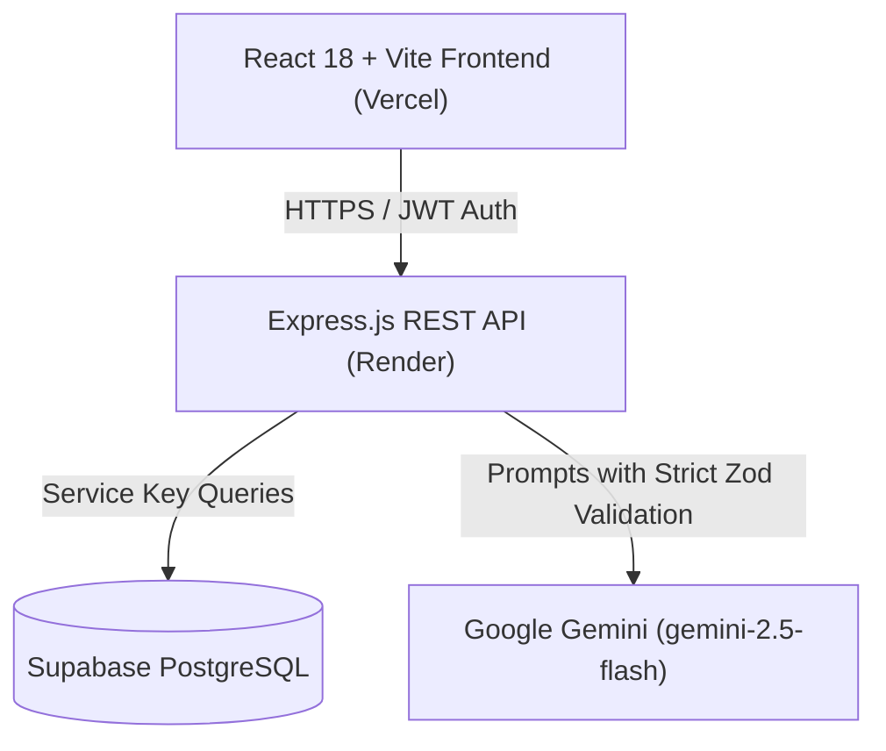

# System Architecture

## 1. Overview
The **AI-Powered Placement Drive Coordinator** is an enterprise-grade campus recruitment automation platform. It eliminates manual spreadsheet tracking and communication silos by combining **deterministic rule engines** (for eligibility and schedule clash resolution) with **generative AI** (powered by Google Gemini) for resume feedback, interview preparation, student FAQ assistance, and executive drive reports.



---

## 2. Independence and Repository Structure
The repository is split into two completely decoupled folders:
- `frontend/`: Deploys independently to **Vercel**. Communicates strictly via `VITE_API_URL`.
- `backend/`: Deploys independently to **Render**. Exposes REST endpoints on `/api` and health checks on `/health`.

Neither folder imports code, dependencies, or config from the other.

---

## 3. The Boundary: Deterministic vs. AI Engine

A critical design requirement is that **high-stakes compliance decisions must never hallucinate**:

| Responsibility | Mechanism | Why |
|---|---|---|
| **Student Eligibility** | Deterministic Engine | Must be mathematically exact against CGPA, active backlogs, graduating batch, and branch. |
| **Schedule Conflict Detection** | Heuristic Interval Graph | Overlapping interview slots violate physics; requires deterministic conflict detection and resolution. |
| **Shortlist Ranking** | AI Match Scoring (`geminiService`) | Evaluates nuanced textual fit between student project descriptions, tech stack, and company JD. |
| **Resume & ATS Feedback** | AI Analysis (`geminiService`) | Generates actionable improvements, bullet enhancements, and role-specific keywords. |
| **Interview Preparation** | AI Prep Generator (`geminiService`) | Suggests domain topics, behavioral practice questions, and 7-day study plans. |
| **Student Assistant** | Grounded RAG FAQ (`geminiService`) | Answers queries strictly using the student's personal schedule and application context. |

---

## 4. Conflict-Aware Scheduling Engine

```mermaid
sequenceDiagram
    participant C as Coordinator
    participant S as Scheduler Service
    participant DB as Supabase DB

    C->>S: POST /drives/:id/schedule/generate (Rooms, Date, Duration, Buffer)
    S->>DB: Fetch global schedule_slots across all drives
    S->>S: Build chronological interval map & detect overlaps
    S->>S: Apply fewest-alternatives greedy heuristic
    Note over S: If conflict detected, prioritize higher match score; displace other slot
    S->>C: Return Preview with Clash Resolution Notes
    C->>S: POST /drives/:id/schedule/confirm
    S->>DB: Atomically persist timetable & trigger notifications
```

### Heuristic Strategy:
1. **Fewest Alternatives First**: Students shortlisted in multiple overlapping drives are scheduled first.
2. **Buffer Enforcement**: A configurable rest buffer (default: 15 mins) is maintained between interviews.
3. **Automatic Clash Resolution Policy**: When two drives schedule a student concurrently, the drive with the higher candidate `match_score` retains the slot. The conflicting slot is marked `rescheduled` with a detailed audit note.

---

## 5. Security & Reliability
- **Role-Based Access Control**: `student`, `coordinator`, and `admin` roles verified via cryptographically signed JWTs.
- **Fail-Safe AI Integration**: Every Gemini SDK invocation includes a 20-second timeout, 2 exponential backoff retries, and strict `zod` schema parsing. If confidence is below `AI_CONFIDENCE_THRESHOLD` (0.7), the record is flagged for coordinator review.
- **Audit Trails**: All critical decisions (criteria edits, shortlist approvals, manual overrides) are written to `audit_logs` with before/after state diffs.
